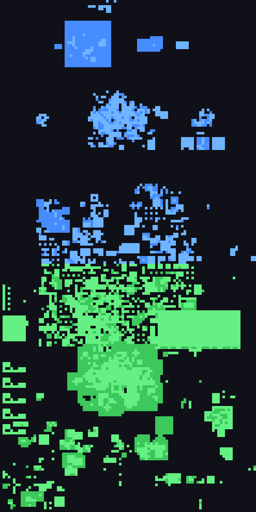

# Collision Map

Walking collision for the whole RS3 map, for plugins that need to know where you can and can't walk. The API only gives you interactive stuff like doors and gates, so this fills in the rest (walls, scenery, rocks, water, cliffs). It's all built ahead of time from the game cache.

It's a library, so players won't use it directly. It started out as part of my Path Marker plugin and I split it out so other plugins can use it too: agility helpers, true tile tools, anything that needs pathing. It's still early and dev world only.



*Every map square with collision data (4,916 of them, each 64×64 tiles), north up. Green is the overworld, blue is the underground band the game keeps far to the north (dungeons, caves), and lighter squares also have upper floors. Dark means there's no map there at all.*

## Getting help

If you find a spot where it's wrong, open an issue (or a PR) with the tile coordinates, or message me on Discord: @wandernaut

## Known issues

These aren't in the cache, some of these need to be done in your own plugin:

- **Doors and gates as they are right now.** The cache only stores each door one way, and whether it's open is live state. Grab door objects from `LocList` and let them override the wall on their tile.
- **Objects the server spawns,** like the chests and safes in heists. `LocList` reports them.
- **Instances [WIP]** (boss rooms, heists, POH). An instance is a copy of a map area at different coordinates, so looking up an instance's own coordinates finds nothing. Mapping instance tiles back to where they came from (`World.GetRegionSourceForCoordGrid`) still needs to be done.
- **NPCs [WIP]** Some NPCs block movement, but they move around, so they can't go in a static map. Instead there's a hand-written list in `npcs.lua`, like the OSRS Path Marker's [`npc_blocking.txt`](https://github.com/GeChallengeM/path-marker/blob/HEAD/src/main/resources/com/pathmarker/npc_blocking.txt). It only has two so far (the Large Jellyfish underwater at 5192, 771, and Icthlarin), so if you find an NPC you can't walk through, send me its ID. Check the NPCs around you from `NPCList` with `blocksNpc` each tick. The game's route ignores them at first: you walk up to one, and when the next step would land on it, the game routes again from there with its tile blocked. So search once without them, stop the walk in front of one, then search again from there with their tiles blocked.
- **Wall corners [WIP].** These are in the cache but skipped for now. A corner piece (a pillar or post where walls meet) stops you stepping diagonally past that corner of its tile, even though you can walk onto the tile itself, like the washing line in east Varrock at 3239, 3420. Almost all corners sit where walls already block that diagonal, so only a few hundred across the map make a difference. I'm going to add back just those, as a small list per map square, so tiles stay at 5 bits.

## Setup

1. Download the zip from [Releases](../../releases) and unzip it into `RuneScape-BETA/dev_plugins/`, so you end up with `dev_plugins/collision-map/`. (Cloning the repo there works too, it just brings the build tools along.)
2. Add it to your plugin's `plugin.json`. Name it whatever you want, the key is the variable you'll use:

   ```json
   "requiredDependencies": { "CollisionMap": "collision-map" }
   ```

   Use `optionalDependencies` instead if your plugin still works without it, and check `if CollisionMap then` before using it.

3. Run `prf` and `pon collision-map` before turning your plugin on.

## Using it

```lua
local map = CollisionMap

map.blocked(level, x, z)                -- true if no one can stand on this tile
map.wall(level, x, z, "N")              -- true if a wall stands on that side of the tile ("N", "E", "S", "W")
map.canMove(level, x, z, dx, dz)        -- can you step from x, z by dx, dz (each -1, 0 or 1)?
map.bits(level, x, z)                   -- the raw bits: 1 blocked, 2 north wall, 4 east, 8 south, 16 west
map.square(level, squareX, squareZ)     -- a whole 64x64 map square as a flat x, z, bits list, or nil
map.blocksNpc(configID)                 -- true if this NPC blocks the player (by its current config ID)
```

- Coordinates are world tiles (`CoordGrid.x`, `.z`, `.level`).
- `canMove` uses the client's rule: a diagonal step needs both straight steps around its corner to be open, so it never cuts past a blocked tile or a wall. A wall is only stored on one tile, so `wall` reports it from that tile, but `canMove` checks both sides of the edge.
- Data for an area loads the first time you ask about it, a few KB at a time, and stays loaded. The lists `square` returns are shared, so don't modify them.

## The data

`data/` holds the map in 587 small files, each covering 4×4 map squares (256×256 tiles), about 1.4 MB zipped. It was built from the game cache on 2026-10-23, decoded with [rs3cache](https://github.com/mejrs/rs3cache) (credit: mejrs). I also decoded it a second way with a decoder of my own, and the two matched tile for tile on the squares I compared them on (the GE, Varrock and Kharid-et). It's been checked in game around the game in various places but nothing exhaustive, so I'm hoping sharing will lead to more of that exposure. Rebuilding takes about a minute and is only needed when a game update changes the map.

Every map square in the cache is covered, on all 4 levels: 4,916 squares with collision. Green is the overworld (main continent, islands, Anachronia, Havenhythe), blue is the underground band the game keeps far to the north, and lighter squares have upper floors.

Shipping data from Jagex's cache in a plugin hasn't been cleared with Jagex yet, so for now this is just for testing on dev worlds. Of course having an API for local collision data would solve the majority of use cases for this - hence OSRS only needing it for the very complex Shortest Path plugin.

### How it's made

1. **Copy the cache.** The game keeps its cache in `C:\ProgramData\Jagex\RuneScape` as SQLite files. Three of them matter: `js5-5.jcache` (map squares), `js5-16.jcache` (object configs) and `js5-2.jcache` (general configs). I copy them somewhere else first, since the client might be running. The client downloads the whole map in the background, but it's worth checking every map square the cache lists is actually stored before building.
2. **Decode it.** [rs3cache](https://github.com/mejrs/rs3cache) (mejrs, MIT) turns those files into JSON: every map square's tiles, every object placed on them, and every object's config. It needed a small patch first, for four object config opcodes added since it was last updated.
3. **Work out each square's collision.** For every tile on every level:
   - a tile flagged as blocked (water, cliffs and so on) is blocked
   - a bridge moves everything in its column down a level, since you walk on top of it
   - an object only counts if its clip type (the API's `blockWalk`) isn't 0
   - a straight wall blocks one side of its tile, an L-shaped wall two sides, and solid objects block every tile they cover (width and length swap when they're rotated)
   - ground decoration (grass tufts, paving) only blocks at clip type 1, so the usual 2s stay walkable
   - multi-locs use their placed parent object, not the state the API reports, because the state follows each player's own variables
   - big objects from a neighbouring square that reach into this one count too
   - wall corners (for now), wall decorations and roofs are skipped
4. **Encode it.** Each tile becomes 5 bits (blocked, plus a wall on each side). The 4,096 tiles of a square's level are written in order as runs of identical tiles, as text in a 64-letter alphabet, so it can sit in a Lua file.
5. **Group it.** 4×4 squares go in each file, `data/<gx>_<gz>.lua`, because zipping one file per square came out at twice the size.

The scripts for all of this are in [`tools/`](tools/), and [`tools/README.md`](tools/README.md) has the exact commands to rebuild the data yourself.

## Using this with AI tools

You have my permission to use this repo's code, tools and documentation with AI tools, including uploading them to AI models, as far as Jagex's [AI policy](https://developer.runescape.com/rs/submission/guidelines.html) is concerned. The collision data in `data/` is built from the game's cache, so it's Jagex's and not mine to give permission for.
